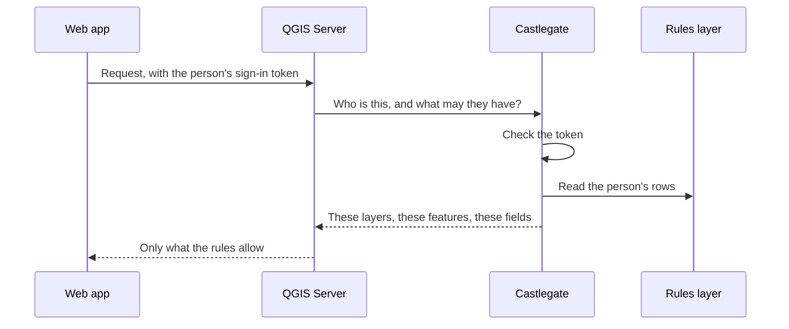

# Castlegate

Castlegate Server is a QGIS Server plugin that gives each person who signs in their own share of a QGIS project: the layers, features and fields they may see, and the edits they may make. People sign in with their organisation account, through OpenID Connect, such as Microsoft Entra ID.

**What an administrator decides, for each person or group**

**Who**
- a person, by their sign-in email or their account's ID
- a group from the sign-in provider, such as an Entra security group

**Layers**
- which layers they see; the rest are left out of what the server gives them

**Features**
- which features they see, such as only the sites in their region
- which features they may edit, such as only the jobs assigned to them

**Fields**
- fields whose values are hidden from them, such as a landowner's phone number
- fields they see but may not change

**Edits**
- adding, changing details, moving and deleting, each allowed on its own

## Where Castlegate fits

QGIS Server publishes a project's layers to anyone who can reach it. It has a place for an access-control plugin to answer its questions, but no sign-in and no rules of its own.

Castlegate is that plugin. It keeps the QGIS project as the one place a server's layers are set up:

- **The rules are a layer of the project,** a table the administrator edits in QGIS like any other ([Setting up a project](#setting-up-a-project)). So each project has its own rules, and they work whatever the layers are stored in: SQL Server, PostGIS, a GeoPackage, or anything else QGIS can open.
- **Staff need no database login of their own.** QGIS Server reads the data with one account, and Castlegate decides what each person gets from it.
- **A rule is a QGIS expression,** the same kind a QGIS user already writes for a filter or a label.
- **Sign-in is standard OpenID Connect.** Castlegate checks the token each request carries: its signature, issuer, audience, scope, expiry and, where set, tenant. Microsoft Entra ID is the provider it has been tested with.

## How a request is checked



A request with no valid sign-in gets nothing but a 401. A save that sets a hidden or read-only field, or touches a feature the person may not edit, is refused. QGIS Server asks Castlegate about every feature a change touches, before the change and after it, so a change cannot move a feature out of what the person may edit.

## What a rules table looks like

Three rows from a made-up council's rules, for a `trees` layer and a `requests` layer:

| kind | who | layer | can_see | can_add | can_change | can_move | can_delete | see_filter | edit_filter | hidden_fields | readonly_fields |
|---|---|---|---|---|---|---|---|---|---|---|---|
| group | *the Parks team's group ID* | trees | yes | yes | yes | yes | yes | | | | |
| group | *the contractors' group ID* | trees | yes | no | yes | no | no | | `"assigned_to" = {{email}}` | cost | species |
| person | ana@example.org | requests | yes | no | no | no | no | `"ward" = 'North'` | | caller_phone | |

- **The Parks team** see every tree and may make any edit to any of them.
- **A contractor** sees every tree but not its cost, and may change only the trees assigned to them, and not their species.
- **Ana** sees the requests from the North ward, without the caller's phone number, and may not edit them.

`{{email}}` stands for the signed-in person's email, and Castlegate quotes it itself. A person in several groups gets everything any of their rows allows: there are no rows that take a right away. [`docs/rules-table.md`](docs/rules-table.md) gives every column and how rows combine.

## Setting up a project

A GIS administrator adds three things to a QGIS project:

1. **A rules table:** a table with no geometry and the columns in [`docs/rules-table.md`](docs/rules-table.md). It can be a GeoPackage beside the project, made in QGIS with **Layer, Create Layer, New GeoPackage Layer** and the geometry type **No Geometry**, or a table in SQL Server, PostGIS or anything else QGIS can open.
2. **That table, as a layer of the project.**
3. **The project variable `castlegate_rules_layer`**, set to that layer's name, in **Project Properties, Variables**.

Castlegate never publishes the rules layer, whatever the project's publishing settings say. A project without the variable, or whose rules layer cannot be read, publishes nothing. From then on, access is managed by editing rows in QGIS, and a change applies within 30 seconds, with no need to publish the project again.

**Who else takes part**

- **No database administrator is needed to give people access.** Nobody gets a database login or a grant of their own: QGIS Server reads the data with the one account it uses today, and Castlegate decides what each person gets from it.
- **A database administrator is needed once, if the rules table is in the database:** to create it, let QGIS Server's account read it, and let the GIS administrator edit it. A GeoPackage beside the project needs none of that.
- **Whoever can edit the rules table decides who sees what,** so only the people who manage access should be able to change it: through the table's permissions in the database, or the folder's permissions for a GeoPackage.
- **The sign-in administrator,** in Entra for example, registers the app whose sign-ins the server accepts, and gives the ID of each group a row names.
- **The server administrator** installs the plugin ([`install/`](install/README.md)).

## For IT

- **One plugin folder.** Castlegate needs no Python package beyond what QGIS Server ships: it checks token signatures with Python's own standard library.
- **Settings in environment variables,** the one channel every web server in front of QGIS Server offers ([`install/README.md`](install/README.md#the-settings)).
- **Beside an existing QGIS Server on IIS.** One PowerShell script sets up a second QGIS Server with Castlegate, with its own pool, FastCGI entry and folder, and leaves the existing server's settings as they are ([`install/iis/`](install/iis/README.md)). A Windows Server 2022 machine runs it end to end on every change to it.
- **Docker, Apache and nginx.** The Docker profile is complete, and the plugin's own tests run on it. Apache and nginx have guides, not yet tested.
- **It refuses when something goes wrong.** An error inside Castlegate refuses the request. The one way it fails open is QGIS Server starting without the plugin, so the status check tells the two apart, for your monitoring ([`install/common/`](install/common/README.md)).
- **An audit line for every save,** in QGIS Server's log, with the person's ID and email, the layer, the kind of edit and whether it went through.
- **A rules change applies within 30 seconds,** with no restart.

## What Castlegate leaves out

Castlegate protects QGIS Server's WMS and WFS services, and refuses every other service. It does not protect the database: someone with a database login is not covered by its rules. A layer's style can show a hidden field's values, so style and label a layer only by fields everyone who sees it may see.

[`docs/limits.md`](docs/limits.md) lists every limit, including what a person can still learn about a hidden field and how the plugin affects speed.

## Try it

The plugin's tests run against a real QGIS Server, with Node.js and Docker. They start a stand-in sign-in provider and QGIS Server in containers, and print one line per check: a hidden layer left out, a filtered feature missing, a refused save, a bad token turned away.

```bash
node tests/server/run.mjs --image qgis/qgis-server:ltr
```

## Security

Castlegate has not yet been reviewed by anyone outside Vectoria, and reviews are welcome. [`docs/security-review.md`](docs/security-review.md) is the brief for a reviewer: what Castlegate must hold to, who it guards against, and where to read closest. Report a problem privately, as [`SECURITY.md`](SECURITY.md) says.

## What this repository holds

- `core/`: what every Castlegate product shares, in plain Python with no QGIS: the rules table's shape, the sign-in check that turns a token into a person and their groups, and how the rows naming a person combine.
- `server/castlegate_server/`: Castlegate Server, the QGIS Server plugin. `scripts/build.py` copies `core/` into it and makes the folder and zip that are installed:

  ```bash
  python scripts/build.py
  ```

- `install/`: how to set it up behind each web server, and the status check every setup ends with.
- `tests/core/` and `tests/plugin/`: tests of `core/` and of the plugin's request readers, in plain Python 3.12 or later:

  ```bash
  python -m unittest discover -s tests/core -t .
  ```

  ```bash
  python -m unittest discover -s tests/plugin -t .
  ```

- `tests/server/`: the plugin's tests against a real QGIS Server, above. CI runs them on the long-term release and the latest release of the `qgis/qgis-server` image. With `CASTLEGATE_BACKEND=mssql` the layers and rules tables are in SQL Server instead of a GeoPackage, through Microsoft's ODBC Driver 18 and SQL Server 2022 Developer, whose licence terms running them accepts ([ODBC Driver 18](https://aka.ms/odbc18eula), [SQL Server 2022 Developer](https://go.microsoft.com/fwlink/?linkid=857698)). CI runs that only when someone starts it (`.github/workflows/sql-server.yml`).
- `spike/`: the first prototype and the harness that runs its checks against the Docker QGIS Server.

## Where Castlegate came from

Castlegate began as part of Groundwork, Vectoria's web app for capturing and editing spatial data, so that an organisation's staff could sign in to Groundwork and get only their share of a QGIS Server. Groundwork is the app it has been tested with, and the install profiles set up the browser access Groundwork's address needs.

## Status

Castlegate is pre-1.0, at version 0.1.0, and no release has been published yet. It needs QGIS Server 3.36 or later.

## Licence

Copyright 2026 Vectoria Pty Ltd.

Castlegate is licensed under the GNU General Public License, version 2 or (at your option) any later version ([`LICENSE`](LICENSE)).

## Made by Vectoria

<a href="https://vectoria.com.au"><picture><source media="(prefers-color-scheme: dark)" srcset="assets/vectoria-logo-dark.svg"></picture></a>

[vectoria.com.au](https://vectoria.com.au)
