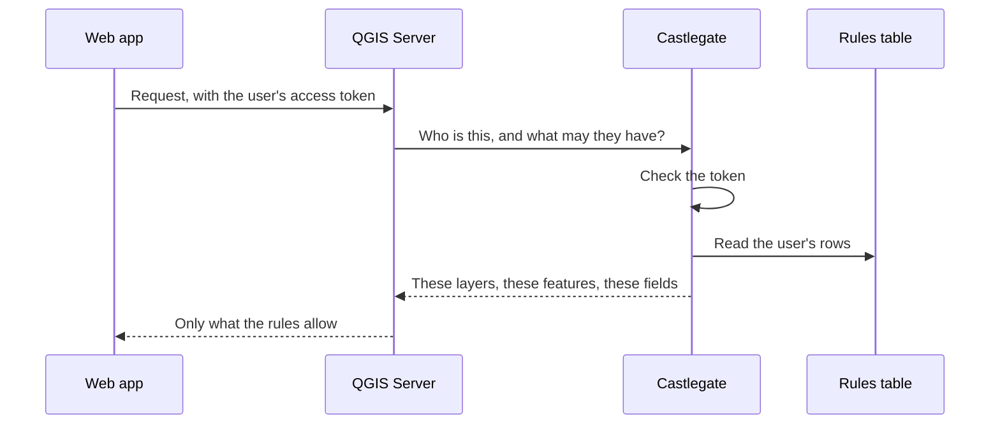
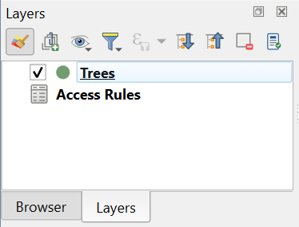
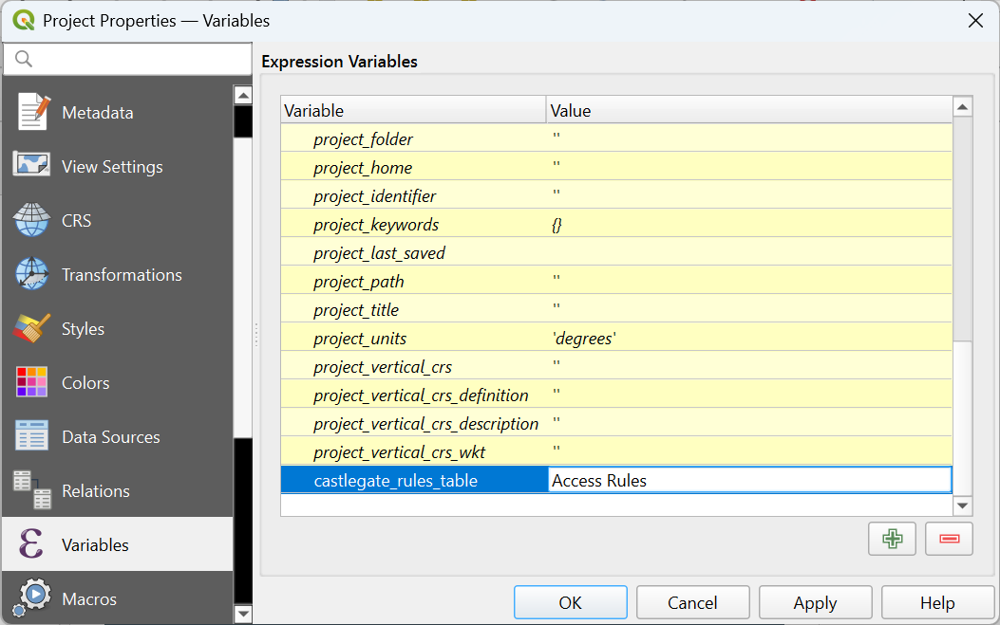
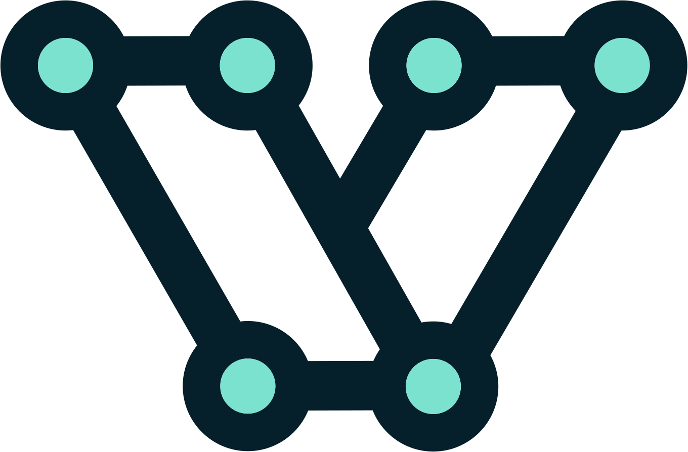

# Castlegate

Castlegate Server is a QGIS Server plugin that gives each user who signs in their own share of a QGIS project: the layers, features and fields they may read, and the edits they may make. Users sign in with their organisation account, through OpenID Connect, such as Microsoft Entra ID.

**What an administrator decides, for each user or group**

**Who**
- a user, by their sign-in email or their object ID
- a group from the identity provider, such as an Entra security group

**Layers**
- which layers they can read; the rest are left out of the capabilities and of every response

**Features**
- which features they read, such as only the sites in their region
- which features they may edit, such as only the jobs assigned to them

**Fields**
- fields whose values are hidden from them, such as a landowner's phone number
- fields they read but may not set

**Edits**
- inserting, updating attributes, updating geometry and deleting, each allowed on its own

## Where Castlegate fits

QGIS Server publishes a project's layers to anyone who can reach it. It has a place for an access-control plugin to answer its questions, but no sign-in and no rules of its own.

Castlegate is that plugin. It keeps the QGIS project as the one place a server's layers are set up:

- **The rules are a table in the project,** edited in QGIS like any other table ([Setting up a project](#setting-up-a-project)). So each project has its own rules, and they work whatever the layers are stored in: SQL Server, PostGIS, a GeoPackage, or anything else QGIS can open.
- **Users need no database login of their own.** QGIS Server reads and writes the project's layers through the project's own data connections, with the one account those connections use ([What needs to be in place](#what-needs-to-be-in-place)). Castlegate decides what each user gets from them.
- **A rule is a QGIS expression,** the same kind a QGIS user already writes for a filter or a label.
- **Sign-in is standard OpenID Connect.** Castlegate checks the access token each request carries: its signature, issuer, audience, scope, expiry and, where set, tenant. Microsoft Entra ID is the identity provider it has been tested with.

## How a request is checked



A request with no valid token gets nothing but a 401. A WFS-T transaction that sets a hidden or read-only field, or touches a feature the user may not edit, is refused. QGIS Server asks Castlegate about every feature an update touches, before the update and after it, so an update cannot move a feature out of what the user may edit.

## What needs to be in place

1. **QGIS Server 3.36 or later, with the Castlegate plugin.** On Windows, one PowerShell script sets up a QGIS Server with Castlegate in IIS, beside the QGIS Server you have, and leaves that server's settings as they are ([`install/iis/`](install/iis/README.md)). Apache, nginx and Docker have guides of their own ([`install/`](install/README.md)).
2. **An account for the project's data connections.** QGIS Server opens the project's layers and the rules table through the project's own data connections, so the account those connections use must read every layer users read and the rules table, and write every layer users edit. On IIS that account is:
   - for SQL Server with Windows authentication, the account the IIS application pool runs as, which the install script sets with `-Credential`;
   - for SQL Server or PostGIS with a database login saved in the project's connection, that login;
   - for a GeoPackage, the application pool's account, which needs rights on the GeoPackage's folder.
3. **An app registration in Entra** for the app users sign in through, issuing version 2 access tokens, with its groups claim turned on if any row names a group. Three settings tell Castlegate which tokens to trust: the issuer, the audience and the scope ([`install/README.md`](install/README.md#the-settings)).
4. **A rules table in each QGIS project** the server publishes ([Setting up a project](#setting-up-a-project)).

Users get no database login or grant of their own, and the account in step 2 is the only one the database sees. Castlegate's audit line in QGIS Server's log records which user made each edit.

## Setting up a project

A GIS administrator adds three things to a QGIS project:

1. **A rules table:** a table with no geometry and the columns in [`docs/rules-table.md`](docs/rules-table.md). Call it whatever suits your projects; we suggest `access_rules`. It can be a GeoPackage beside the project, made in QGIS with **Layer, Create Layer, New GeoPackage Layer** and the geometry type **No Geometry**, or a table in SQL Server or PostGIS, in the schema the project's layers already use. Every column can be text.
2. **That table, added to the project,** so it shows in the Layers panel. Its name there may be friendlier than its name in the database, such as `Access Rules`.

   

3. **The project variable `castlegate_rules_table`**, set to the table's name as the Layers panel shows it, in **Project Properties, Variables**. The variable is also how anyone opening the project later can tell which table Castlegate reads.

   

Castlegate never publishes the rules table, whatever the project's publishing settings say. A project without the variable, or whose rules table cannot be read, publishes nothing.

From then on, access is managed by editing rows of the rules table in QGIS. A change applies within 30 seconds, with no need to publish the project again. Whoever can edit the rules table decides who reads what, so give edit rights on it only to the people who manage access: through the table's permissions in the database, or the folder's permissions for a GeoPackage.

The status check, run with a user's access token, says whether the project's rules loaded and lists any row it left out, with the reason ([`install/common/`](install/common/README.md)).

## What a rules table looks like

Four rows from a made-up council's rules, for a `Trees` layer and a `Requests` layer:

| who_type | who | layer | can_read | can_insert | can_update_attributes | can_update_geometry | can_delete | read_filter | edit_filter | hidden_fields | readonly_fields |
|---|---|---|---|---|---|---|---|---|---|---|---|
| group | 5b8e2a14-3c7f-4d91-a6e0-8f2b7c3d9e41 | Trees | yes | yes | yes | yes | yes | | | | |
| group | 0c6d3f92-8a1b-4e57-b2c9-7d4e1f6a8b30 | Trees | yes | no | yes | no | no | | `"assigned_to" = {{email}}` | `cost, supplier` | `species, planted_date` |
| user | ana.lopez@council.example | Requests | yes | no | no | no | no | `"ward" = 'North'` | | `caller_phone, caller_email` | |
| user | 9d2f4c7a-61e3-4b8d-a0f5-3c7e2b9d1a46 | Requests | yes | no | yes | no | no | `"assigned_to_id" = {{oid}}` | `"assigned_to_id" = {{oid}}` | `caller_phone` | `ward, received_date` |

- **The Parks team's group** reads every tree and may make any edit to any of them.
- **The contractors' group** reads every tree without its cost or supplier. A contractor may update the attributes of only the trees assigned to them, and not their species or planting date. They cannot insert, move or delete trees.
- **Ana,** named by her sign-in email, reads the requests from the North ward without the caller's phone or email, and may not edit them.
- **A field officer,** named by their object ID, reads only the requests assigned to them, and may update those requests' attributes except the ward and the date received.

`{{email}}` and `{{oid}}` stand for the signed-in user's email and object ID, and Castlegate quotes them itself. A field list takes names separated by commas. The IDs are made up; an Entra object ID has this form, and the Microsoft Entra admin center shows it on the user's or group's Overview page.

A user gets everything any of their rows allows: there are no rows that take a right away. So a layer no row names is read by nobody, and a user no row names gets nothing. [`docs/rules-table.md`](docs/rules-table.md) gives every column, the ways to name a user or a group, and how rows combine.

## For IT

- **One plugin folder.** Castlegate needs no Python package beyond what QGIS Server ships: it checks token signatures with Python's own standard library.
- **Settings in environment variables,** the one channel every web server in front of QGIS Server offers ([`install/README.md`](install/README.md#the-settings)).
- **Beside an existing QGIS Server on IIS.** The install script gives the new QGIS Server its own application pool, FastCGI entry and folder ([`install/iis/`](install/iis/README.md)). A Windows Server 2022 machine runs it end to end on every change to it.
- **Other web servers.** The Docker profile is complete, and Castlegate's own tests run on it. Apache and nginx have guides, not yet tested.
- **It refuses when something goes wrong.** An error inside Castlegate refuses the request. The one way it fails open is QGIS Server starting without the plugin, so the status check tells the two apart, for your monitoring ([`install/common/`](install/common/README.md)).
- **An audit line for every edit,** in QGIS Server's log, with the user's object ID and email, the layer, the kind of edit and whether it went through.
- **A rules change applies within 30 seconds,** with no restart.

## What Castlegate leaves out

Castlegate protects QGIS Server's WMS and WFS services, and refuses every other service. It does not protect the database: someone with a database login is not covered by its rules. A layer's style can show a hidden field's values, so style and label a layer only by fields everyone who reads it may read.

[`docs/limits.md`](docs/limits.md) lists every limit, including what a user can still learn about a hidden field and how the plugin affects speed.

## Security

Castlegate has not yet been reviewed by anyone outside Vectoria, and reviews are welcome. [`docs/security-review.md`](docs/security-review.md) is the brief for a reviewer: what Castlegate must hold to, who it guards against, and where to read closest. Report a problem privately, as [`SECURITY.md`](SECURITY.md) says.

## For developers

### What this repository holds

- `core/`: what every Castlegate product shares, in plain Python with no QGIS: the rules table's shape, the sign-in check that turns a token into a user and their groups, and how the rows naming a user combine.
- `server/castlegate_server/`: Castlegate Server, the QGIS Server plugin. `scripts/build.py` copies `core/` into it and makes the folder and zip that are installed:

  ```bash
  python scripts/build.py
  ```

- `install/`: how to set it up behind each web server, and the status check every setup ends with.
- `tests/core/` and `tests/plugin/`: tests of `core/` and of the plugin's request readers, in plain Python 3.12 or later:

  ```bash
  python -m unittest discover -s tests/core -t .
  ```

  ```bash
  python -m unittest discover -s tests/plugin -t .
  ```

- `tests/server/`: the plugin's tests against a real QGIS Server, below.
- `spike/`: the first prototype and the harness that runs its checks against the Docker QGIS Server.

### Running the tests against QGIS Server

These tests need Node.js and Docker. Docker is for the tests only: running Castlegate needs neither. They start a stand-in identity provider and QGIS Server in containers, and print one line per check: a hidden layer left out, a filtered feature missing, a refused transaction, a bad token turned away.

```bash
node tests/server/run.mjs --image qgis/qgis-server:ltr
```

CI runs them on the long-term release and the latest release of the `qgis/qgis-server` image. With `CASTLEGATE_BACKEND=mssql` the layers and rules tables are in SQL Server instead of a GeoPackage, through Microsoft's ODBC Driver 18 and SQL Server 2022 Developer, whose licence terms running them accepts ([ODBC Driver 18](https://aka.ms/odbc18eula), [SQL Server 2022 Developer](https://go.microsoft.com/fwlink/?linkid=857698)). CI runs that only when someone starts it (`.github/workflows/sql-server.yml`).

## Where Castlegate came from

Castlegate began as part of Groundwork, Vectoria's web app for capturing and editing spatial data, so that an organisation's staff could sign in to Groundwork and get only their share of a QGIS Server. Groundwork is the app it has been tested with, and the install profiles set up the browser access Groundwork's address needs.

## Status

Castlegate Server 0.1.0 is published in the [QGIS plugin repository](https://plugins.qgis.org/plugins/castlegate_server/), and its zip is attached to the [`castlegate_server@0.1.0` release](https://github.com/vectoriahq/castlegate/releases/tag/castlegate_server%400.1.0) on GitHub. It is marked experimental, so QGIS's Plugin Manager lists it only where **Show also experimental plugins** is ticked.

## Licence

Copyright 2026 Vectoria Pty Ltd.

Castlegate is licensed under the GNU General Public License, version 2 or (at your option) any later version ([`LICENSE`](LICENSE)).

## Made by Vectoria

<a href="https://vectoria.com.au"><picture><source media="(prefers-color-scheme: dark)" srcset="assets/vectoria-logo-dark.svg"></picture></a>

[vectoria.com.au](https://vectoria.com.au)
